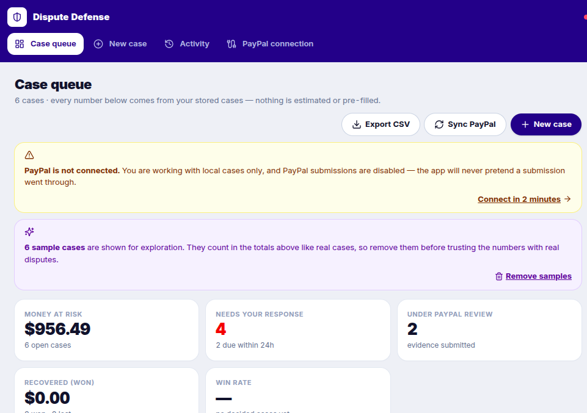
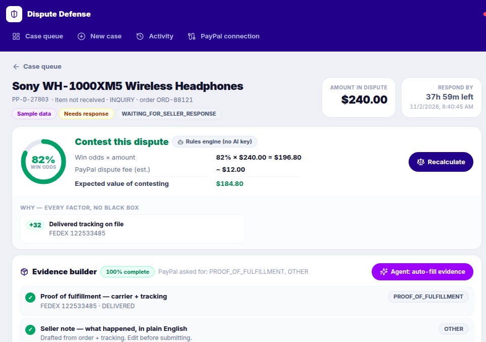

# Dispute Defense Agent — PayPal AI Hackathon 2026

A seller workspace that watches PayPal disputes, scores **contest vs accept** by expected value, **auto-fills the reason-specific evidence pack** PayPal actually asks for, and submits via the Disputes API only after **human approval**. Built with Next.js + AG Grid, deployable to Render.




## Honesty first: what's real here

| Claim | Reality |
|---|---|
| PayPal integration | Direct Disputes API: list, show, `provide-evidence` (with file uploads), `accept-claim`, `make-offer`, `send-message`, webhook receiver with signature verification + dedupe. Beyond the Agent Toolkit, which can only list/get/accept. |
| Agent behaviour | **Auto-fill evidence** re-pulls the live dispute from PayPal, extracts tracking / refund IDs / buyer / due date from PayPal's own evidence payload, re-scores, and reports exactly what it found vs what's still missing. Every step is in the audit trail. |
| Data | Persistent local database (`data/db.json`, atomic writes, corrupt-file guard). Cases, decisions, submissions, and the full audit trail survive restarts. |
| Submissions | Sent to PayPal **only** for PayPal-synced cases when keys are configured. Otherwise the API returns 409 and the attempt is recorded as *not sent*. Nothing is ever simulated or marked successful without a PayPal 200. |
| Metrics | Recovered money and win rate count **recorded outcomes only** (won/lost/accepted). Win rate shows `—` until a case is actually decided. No pre-filled numbers. |
| AI | Deterministic, explainable rules engine (every factor shown with its weight, calibrated by your own decided-case history once you have ≥3 outcomes). If `AI_API_KEY` is set, an LLM decision is requested using the versioned prompt in `/prompts/decide.md`, schema-validated, capped per reason, labelled with the model name; on failure the UI says so and shows the rules decision. |
| Sample data | Opt-in only ("Load sample cases"), labelled SAMPLE everywhere, removable in one click. The app starts empty, and samples start with **no decided outcomes** — win rate is `—` until you record one. |
| Security | Set `APP_ACCESS_PASSWORD` to put the whole workspace behind HTTP Basic Auth (recommended before deploying with PayPal keys). Webhooks verify signatures when `PAYPAL_WEBHOOK_ID` is set, dedupe after verification, and ignore non-dispute events. Uploads are type/size/count validated. |

## Run

```bash
cd dispute-defense
npm install
npm run dev        # http://localhost:3000
npm test           # decision-engine + metrics unit tests
npm run build
```

Starts as a real, empty local case manager: add disputes manually, or load samples to explore.

## Connect PayPal (sandbox, 2 minutes)

1. developer.paypal.com/dashboard → Apps & Credentials → Sandbox → create app.
2. Copy `.env.example` to `.env.local` and set `PAYPAL_CLIENT_ID` / `PAYPAL_CLIENT_SECRET` (`PAYPAL_ENV=sandbox`).
3. Restart, open **PayPal connection** in the app, hit **Test** (real OAuth + dispute read), then **Sync disputes now**.
4. Optional webhooks: point the app's webhook at `https://<your-host>/api/webhooks/paypal` for `CUSTOMER.DISPUTE.*`, set `PAYPAL_WEBHOOK_ID` to enforce signature verification.
5. Deploying? Set `APP_ACCESS_PASSWORD` too — anyone with the URL could otherwise accept claims (real refunds) on a connected account.

## How it works

1. **Detect** — Sync or webhook (`CUSTOMER.DISPUTE.CREATED`) pulls the dispute: reason, amount, `seller_response_due_date`, requested `evidences[].evidence_type`. The queue's deadline watchdog sorts by time left, overdue first.
2. **Enrich** — "Agent: auto-fill evidence" re-reads the dispute from PayPal and fills tracking/refund facts from PayPal's evidence payload — nothing invented, and the workspace lists what was found vs still missing.
3. **Decide** — Win odds from visible factors (delivered tracking +32, refund on file +30, missing proof −25, chargeback cap 65%…); `EV = odds × amount − fee` (fee configurable via `DISPUTE_FEE_USD`, default $12 estimate). Recommendation: contest only when EV > 0 and required evidence exists. Your own win/loss history calibrates the score once you have ≥3 decided cases.
4. **Build evidence** — Checklist mapped per reason: `PROOF_OF_FULFILLMENT` (carrier + tracking), `PROOF_OF_REFUND` (refund ID; required for refund-not-processed, optional for not-as-described), `OTHER` (note, listing text, policy) + document uploads. Contest is blocked while *required* items are missing. The exact JSON payload is previewed before sending — and what you preview is what is saved and sent.
5. **Approve** — Seller confirms in a modal that shows precisely what will be sent. Nothing money-moving happens without it.
6. **Submit & track** — Real PayPal response (status, debug ID on errors) is stored; case moves to Under review. Seller records the final outcome; metrics update truthfully.

## Why this wins money back (evidence & assumptions)

- **Missed deadline = automatic loss.** PayPal closes unanswered disputes in the buyer's favour. The queue is sorted by deadline with overdue cases first, and win odds drop visibly as the deadline passes (−20 factor) — the product is built around never missing one.
- **Wrong evidence = lost contest.** PayPal asks for specific `evidence_type`s per reason; the checklist is generated from the dispute's own `evidence_requested`, not a generic form.
- **Contesting everything is also losing.** Every contest risks the dispute fee while it recovers `odds × amount` in expectation. EV gating (`odds × amount − fee > 0`, fee default $12, set `DISPUTE_FEE_USD` to PayPal's current schedule for your account) tells sellers when accepting is the cheaper move — e.g. a $32 case at 25% odds has EV −$4: accept, don't contest.
- **Time saved (labelled assumption):** manually assembling one evidence pack (find tracking, find refund ID, write the note, upload) takes ~15–25 min in the Resolution Center. Auto-fill + drafted note + one approval targets ~2 min. At 10 disputes/month that's roughly 2–4 seller-hours/month returned — validate with your own timings; we state it as an assumption, not a measured result.

## API

| Endpoint | Does |
|---|---|
| `GET/POST /api/disputes` | List (filter/search) / create a manual case |
| `GET/PATCH/DELETE /api/disputes/[id]` | Read / update evidence facts / delete local copy |
| `POST /api/disputes/[id]/decide` | Rules decision (history-calibrated), or validated LLM decision when configured |
| `POST /api/disputes/[id]/enrich` | Agent auto-fill: re-pull dispute from PayPal, extract evidence facts, report found vs missing |
| `GET /api/disputes/[id]/evidence` | Checklist + exact `provide-evidence` payload preview |
| `POST /api/disputes/[id]/submit` | `contest` (multipart w/ files) · `accept` · `offer` · `message` → PayPal, or honest 409/422 |
| `POST /api/disputes/[id]/outcome` | Record won/lost/accepted — drives metrics |
| `GET /api/paypal/status` · `POST /api/paypal/sync` | Live connection test / pull all disputes (paginated) |
| `POST /api/webhooks/paypal` | Verified, deduped dispute events → upsert |
| `GET /api/metrics` · `GET /api/activity` | Outcome-based metrics / audit trail + submissions |
| `POST/DELETE /api/samples` | Load / remove the labelled sample cases |

## Tools

Next.js 16 (App Router), AG Grid (queue: React cell renderers, quick search across ID/buyer/item, filters, CSV export), Render (`render.yaml` with persistent disk). Prompts versioned in `/prompts` and loaded by the decide route at runtime. Tests: `npm test` (node:test, decision engine + metrics).

## Demo (3:00)

See [DEMO.md](DEMO.md) for the full script, including how to stage a real sandbox dispute so the climax is a genuine PayPal `provide-evidence` 200 — and the honest fallback script if you demo without keys.

## Production notes

Swap the JSON store for Postgres behind `src/lib/db.ts` (single seam), add seller auth (password gate included for single-seller deploys), and attach a persistent disk (Render: `render.yaml` already mounts `/var/data` and sets `DATA_DIR`). PayPal calls already handle token caching, pagination, timeouts, `debug_id` surfacing, and live/sandbox switching via `PAYPAL_ENV`.

## License

MIT — see LICENSE.
# Defense-dispute-Agent
